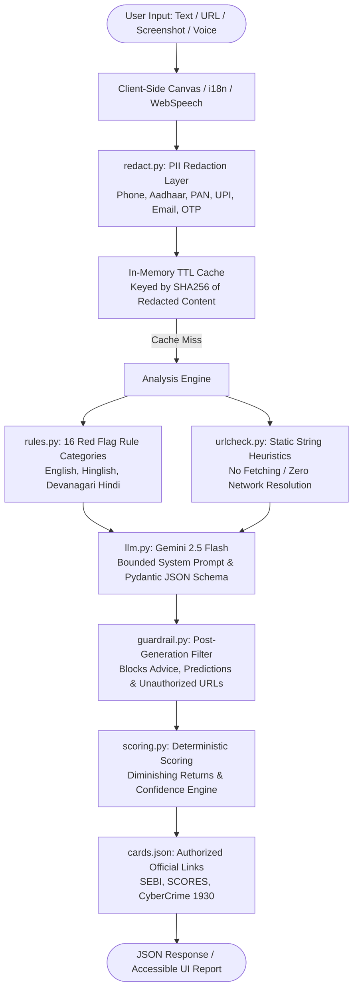

# 🛡️ Nivesh Kavach (निवेश कवच)
> *"Pause. Check. Then decide."*

**Nivesh Kavach** is a privacy-first, hybrid (deterministic rules + Gemini AI) safety checker engineered for Indian retail investors for the **SANGYAN hackathon**. It analyses suspicious investment messages, chat screenshots, and links across English, Hinglish, and Hindi (Devanagari script), transparently explaining the underlying psychological tricks and red flags.

> [!IMPORTANT]
> **What Nivesh Kavach IS NOT:**
> - It is **NOT** a chatbot.
> - It is **NOT** an investment advice or financial advisory tool.
> - It **NEVER** gives buy/sell/hold calls, target prices, or return predictions.
> - It **NEVER** promotes or reviews brokers, securities, or schemes.

---

## 🏛️ Architecture Overview

Nivesh Kavach operates on a layered, fail-safe architecture where deterministic rules and string heuristics run first, followed by bounded AI reasoning and a post-generation compliance filter.



---

## 🔒 Privacy & Security Design

Nivesh Kavach enforces strict privacy guardrails:

1. **Zero Database Architecture**: No SQLite, Postgres, or disk logging. The application does not store, retain, or transmit user messages or images.
2. **Deterministic PII Redaction (`redact.py`)**:
   - Indian mobile numbers: `[PHONE]`
   - 12-digit Aadhaar patterns: `[ID]`
   - PAN card numbers: `[PAN]`
   - UPI Virtual Payment Addresses: `[UPI]`
   - Email addresses: `[EMAIL]`
   - 9–18 digit bank account numbers: `[ACCOUNT]`
   - One-Time Passwords: `[OTP]`
3. **Safe In-Memory Cache**:
   - Cache keys are generated using `SHA-256(redacted_text | url | lang | image_hash)`.
   - In-memory time-to-live (TTL) of **10 minutes** to prevent redundant API queries.
   - User content is never logged.
4. **Client-Side Image Privacy**:
   - Images are downscaled client-side via HTML5 Canvas (max 1024px) before uploading, stripping camera and GPS EXIF metadata.
   - Memory-only image buffers are inspected without saving to disk.
5. **No URL Fetching Policy (`urlcheck.py`)**:
   - The application **NEVER** makes outbound HTTP connections or DNS lookups to user-submitted links.
   - URL analysis is 100% static string inspection (Punycode, raw IP hosts, suspicious TLDs, excessive subdomains, brand typosquatting).

---

## 📋 Guardrail Compliance Checklist

| Requirement | Implementation Module | Status |
| :--- | :--- | :--- |
| **No Buy/Sell/Hold Advice** | `app/guardrail.py` | ✅ Verified with Unit Tests |
| **No Price/Return Predictions** | `app/guardrail.py` | ✅ Regex filters out target prices & growth promises |
| **Never Ask for Credentials** | System-wide policy & UI | ✅ Never requests OTP, password, or PIN |
| **No Unauthorized External Links** | `app/guardrail.py` | ✅ Strips any URL not in `cards.json` |
| **Official Links Whitelist Only** | `app/cards.json` | ✅ Only `sebi.gov.in`, `siportal.sebi.gov.in`, `cybercrime.gov.in`, `scores.sebi.gov.in` |
| **Non-Validation of Reg Claims** | `app/rules.py` | ✅ SEBI reg numbers extracted as unverified claims to verify |
| **Graceful LLM Degradation** | `app/llm.py` | ✅ On 429/network errors, falls back to deterministic rules with `ai_available=False` |

---

## 🌐 Bilingual & Accessibility Features

- **Languages Supported**: English (`en-IN`) and Hindi (`hi-IN`).
- **Single Translation File**: All UI labels, risk descriptions, advice warnings, and cards are maintained in `static/i18n.js`.
- **System Font Stack**: Uses native system fonts (`Nirmala UI`, `Segoe UI`, `Roboto`) to display Devanagari with zero web-font latency and high contrast.
- **Accessible Risk Display**: Risk levels are never conveyed by color alone; they always include a descriptive icon, severity level name, and explanatory headline.
- **Voice Read-Aloud**: Uses `window.speechSynthesis` with device language detection.
- **Voice Input**: Web Speech API with explicit cloud processing transparency notice.
- **Total Frontend Asset Weight**: **~48 KB** (well under the 150 KB limit), with **zero external CDN dependencies**.

---

## 🤖 Gemini Free-Tier Data-Use Disclosure

> [!NOTE]
> When using the Gemini API under Google AI Studio's free tier, Google may log model prompts and completions for product improvement and model training in accordance with the [Google Generative AI Terms of Service](https://ai.google.dev/terms).
> 
> To safeguard user confidentiality, **Nivesh Kavach executes regex PII redaction (`redact.py`) BEFORE sending any content to the Gemini API**, ensuring telephone numbers, PAN cards, Aadhaar IDs, UPI handles, bank accounts, and OTPs never reach external LLM endpoints.

---

## ⚙️ Setup and Installation

### Prerequisites
- Python 3.11+
- Git

### 1. Clone & Set Up Virtual Environment
```bash
git clone <repo-url> C:\NIVESHKAVACH
cd C:\NIVESHKAVACH

python -m venv venv
# On Windows PowerShell:
.\venv\Scripts\Activate.ps1
```

### 2. Install Dependencies
```bash
python -m pip install -r requirements.txt
```

### 3. Configure Environment Variables
Copy `.env.example` to `.env`:
```bash
cp .env.example .env
```
Edit `.env`:
```ini
GEMINI_API_KEY=your_gemini_api_key_here
GEMINI_MODEL=gemini-2.5-flash
```
*(Note: If no Gemini API key is provided, Nivesh Kavach operates in deterministic rules-only mode with full safety checks intact!)*

### 4. Run the Application
```bash
python -m uvicorn app.main:app --host 127.0.0.1 --port 8000 --reload
```
Open your browser at: **`http://127.0.0.1:8000`**

---

## 🧪 Testing and Benchmark Evaluation

Run unit and integration test suite:
```bash
python -m pytest -v
```
*(49/49 tests covering redaction, rule regexes, URL inspection, guardrails, scoring, and API endpoints)*

Run the benchmark evaluation script over synthetic test cases:
```bash
python eval.py
```

### Benchmark Results (`tests/samples.json`):
- **Scam Recall (Any warning flag >= 20)**: **100.0%** (12/12)
- **Scam Recall (High/Very High Risk >= 45)**: **83.3%** (10/12)
- **Benign False-Positive Rate**: **0.0%** (0/6 genuine bank/SIP alerts wrongly flagged)
- **Ambiguous Sample Handling**: Clean low risk baseline

---

## 📦 Third-Party Components

- **FastAPI**: Modern, high-performance web framework.
- **Uvicorn**: ASGI server implementation.
- **Pydantic**: Data validation and strict JSON schema generation.
- **Google GenAI SDK (`google-genai`)**: Official SDK for multimodal structured inference.
- **Pillow**: In-memory image validation.
- **Pytest**: Automated test framework.

---

## ⚠️ Limitations

1. **Synthetic Evaluation Dataset**: The included benchmark (`tests/samples.json`) contains 21 synthetic, fictional samples designed for hackathon validation; real-world adversary variations are broader.
2. **Static URL String Heuristics**: Because Nivesh Kavach adheres to the strict rule of never fetching external URLs, newly registered domains without obvious suspicious keywords may not trigger URL heuristic rules.
3. **Browser Speech Engine Dependency**: Web Speech API speech-to-text and read-aloud depend on local browser/OS voice packs. On devices without Hindi TTS voices, the system gracefully falls back to text display.
